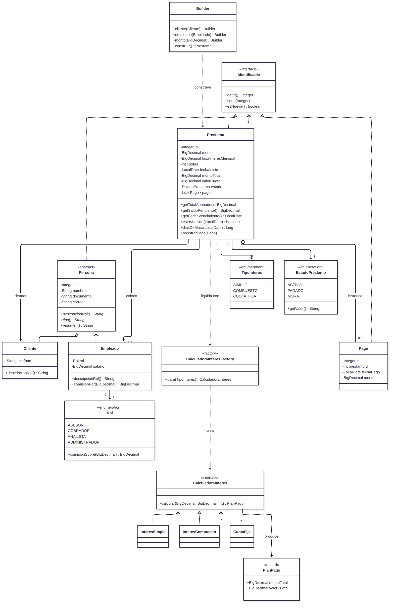
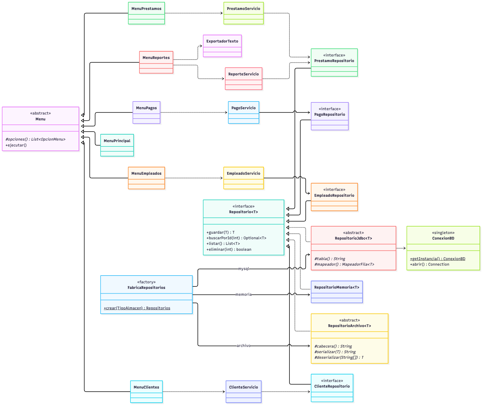
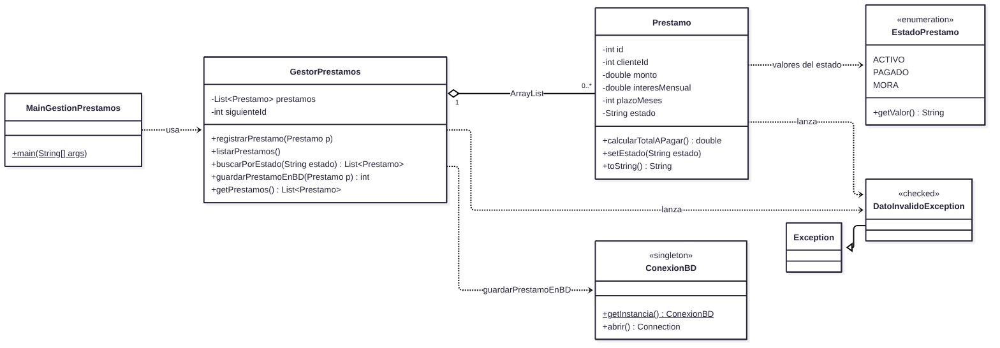

# CrediYa S.A.S. — Sistema de Cobros de Cartera

Aplicación de consola en Java para administrar los préstamos personales de CrediYa S.A.S.:
empleados, clientes, créditos, abonos y reportes de cartera, con persistencia en **MySQL
(JDBC)** y en **archivos de texto**.

Reemplaza las hojas de cálculo con las que la empresa venía trabajando y agrega lo que una
hoja de cálculo no puede dar: validación de los datos al momento de capturarlos, cálculo
automático de intereses, control de que nadie abone más de lo que debe y reportes de mora
calculados sobre la información real.

---

## Tabla de contenido

1. [Examen: gestión de préstamos y cálculo de intereses](#examen-gestión-de-préstamos-y-cálculo-de-intereses)
2. [Qué hace el sistema](#qué-hace-el-sistema)
3. [Cómo ejecutarlo](#cómo-ejecutarlo)
4. [Base de datos](#base-de-datos)
5. [Estructura del proyecto](#estructura-del-proyecto)
6. [Diagramas](#diagramas)
7. [Decisiones de diseño](#decisiones-de-diseño)
8. [Ejemplos de uso](#ejemplos-de-uso)
9. [Pruebas](#pruebas)
10. [Alcance y limitaciones conocidas](#alcance-y-limitaciones-conocidas)

---

## Examen: gestión de préstamos y cálculo de intereses

Esta funcionalidad vive en el paquete `com.crediya.gestion`.

| Requisito del enunciado | Dónde está |
|---|---|
| 1. Clase `Prestamo` con `id`, `clienteId`, `monto`, `interesMensual`, `plazoMeses` y `estado`; constructores, getters y setters, `calcularTotalAPagar()` y `toString()` | [`gestion/Prestamo.java`](src/main/java/com/crediya/gestion/Prestamo.java) |
| 2. `GestorPrestamos` con un `ArrayList`: `registrarPrestamo(Prestamo p)`, que lanza `DatoInvalidoException` si el monto o el plazo no son mayores que 0, y `listarPrestamos()` | [`gestion/GestorPrestamos.java`](src/main/java/com/crediya/gestion/GestorPrestamos.java), [`gestion/DatoInvalidoException.java`](src/main/java/com/crediya/gestion/DatoInvalidoException.java) |
| 3. `guardarPrestamoEnBD(Prestamo p)`: inserta en la tabla `prestamos` de `crediya_db` con `ConexionBD` (Singleton) | `GestorPrestamos.guardarPrestamoEnBD` |
| 4. `buscarPorEstado(String estado)` con Stream API y lambdas | `GestorPrestamos.buscarPorEstado` |
| Script SQL actualizado | [`sql/crediya_db.sql`](sql/crediya_db.sql) |
| Ejemplo de ejecución | [`gestion/MainGestionPrestamos.java`](src/main/java/com/crediya/gestion/MainGestionPrestamos.java) |

### Compilar y ejecutar

Requisitos: JDK 17 o superior y Maven 3.8+.

```bash
git clone https://github.com/isnowyy/Examen_Java_NaranjoNicolas.git
cd Examen_Java_NaranjoNicolas
./run.sh gestion
```

Equivalente sin el script:

```bash
mvn compile
mvn exec:java -Dexec.mainClass=com.crediya.gestion.MainGestionPrestamos
```

O con el ejecutable empaquetado:

```bash
mvn package
java -cp target/crediya-jar-with-dependencies.jar com.crediya.gestion.MainGestionPrestamos
```

Todo funciona en memoria, sin nada más instalado, salvo la última sección, que guarda en
MySQL. Para que esa sección funcione, primero cree la base y configure la conexión como se
explica en [Base de datos](#base-de-datos).

### Ejecución

```
=== REGISTRO DE PRÉSTAMOS ===
Préstamo registrado correctamente.
Préstamo registrado correctamente.
Préstamo registrado correctamente.
Error: El monto debe ser mayor que 0 (se recibió 0.0).
Error: El plazo debe ser mayor que 0 meses (se recibió 0).
Error: El estado 'Cancelado' no es válido. Valores posibles: Activo, Pagado, Mora.

=== LISTADO DE PRÉSTAMOS ===
ID: 1 - Cliente: 5 - Monto: 500000.0 - Interés: 2.5% - Plazo: 6 meses - Total: 575000.0
ID: 2 - Cliente: 2 - Monto: 2000000.0 - Interés: 3.0% - Plazo: 12 meses - Total: 2720000.0
ID: 3 - Cliente: 3 - Monto: 1200000.0 - Interés: 2.0% - Plazo: 4 meses - Total: 1296000.0

=== PRÉSTAMOS EN ESTADO 'Activo' ===
Préstamo ID 1 - Estado: Activo

=== PRÉSTAMOS EN ESTADO 'Mora' ===
Préstamo ID 2 - Estado: Mora

=== GUARDADO EN MySQL (tabla prestamos) ===
Préstamo ID 1 guardado en la base de datos con ID 7.
Préstamo ID 2 guardado en la base de datos con ID 8.
Préstamo ID 3 no se guardó: Un préstamo nuevo no puede guardarse como Pagado: pasa a ese estado cuando sus abonos cubren el total, y todavía no tiene ninguno.
```

Las tres líneas que muestra el enunciado (registro, listado y filtro por `'Activo'`) salen
iguales. Además se registran préstamos en `Mora` y `Pagado` y tres datos inválidos, para que
se vea el filtro descartando préstamos y la excepción en acción.

Los ID de la base (7 y 8) son los que asigna MySQL justo después de correr
`sql/crediya_db.sql`, que trae 6 préstamos de ejemplo. Cada ejecución inserta dos filas más.

Si MySQL no está disponible, la parte en memoria funciona igual y la última sección lo avisa:

```
=== GUARDADO EN MySQL (tabla prestamos) ===
Error de base de datos: No se pudo conectar con MySQL en jdbc:mysql://localhost:3306/crediya_db?... Revise que el servidor este encendido y que las credenciales de crediya.local.properties sean correctas.
Los préstamos quedaron solo en memoria. El detalle está en datos/bitacora.log
```

### Cómo está resuelto

**Cálculo del total.** `calcularTotalAPagar()` aplica la fórmula del enunciado:

```java
return monto + (monto * interesMensual / 100 * plazoMeses);
```

Con 500.000 al 2,5 % durante 6 meses: 500.000 + 500.000 × 0,025 × 6 = **575.000**. Es interés
simple, la misma fórmula de `InteresSimple` en el resto del sistema. Por eso, cuando la
aplicación principal lee de la base un préstamo guardado por el gestor, calcula el mismo total.

**Encapsulamiento.** Los seis atributos son privados. El estado es un `String`, pero
`setEstado` solo admite `"Activo"`, `"Pagado"` y `"Mora"`, sin distinguir mayúsculas, y
cualquier otro valor lanza `DatoInvalidoException`. Monto y plazo no se validan en el
constructor sino en `registrarPrestamo`, que es donde el enunciado pone esa regla. Si el
constructor ya los rechazara, la validación del gestor nunca llegaría a ejecutarse.

**Validaciones de `registrarPrestamo`.** Todas lanzan `DatoInvalidoException` y dejan la lista
sin cambios:

| Regla | Origen |
|---|---|
| Monto mayor que 0 (también rechaza `NaN` e infinito) | Enunciado |
| Plazo mayor que 0 | Enunciado |
| Plazo de máximo 120 meses e interés entre 0 y 100 % | `CHECK` de la tabla `prestamos`. Validarlos aquí da un mensaje claro en vez de un error de MySQL. |
| ID de cliente mayor que 0 | El préstamo tiene que pertenecer a alguien. |
| ID no repetido | Si el préstamo llega con ID 0, el gestor le asigna el siguiente. |

**`DatoInvalidoException` es una excepción verificada** (`extends Exception`), a diferencia de
las demás del sistema. Un dato inválido es un error esperado del que quien llama siempre se
puede recuperar: avisa y sigue con el siguiente préstamo. El `throws` en la firma hace que el
compilador obligue a manejarlo, y por eso `MainGestionPrestamos` lo atrapa en cada operación:

```java
public void registrarPrestamo(Prestamo p) throws DatoInvalidoException {
    validar(p);   // throw new DatoInvalidoException("El monto debe ser mayor que 0 ...")
    ...
}
```

**Stream API.** `buscarPorEstado` normaliza el texto recibido y filtra con una lambda. Un estado
inexistente (`"Cancelado"`) lanza la excepción en lugar de devolver una lista vacía que
escondería el error de digitación:

```java
public List<Prestamo> buscarPorEstado(String estado) throws DatoInvalidoException {
    String buscado = Prestamo.normalizarEstado(estado);
    return prestamos.stream()
            .filter(prestamo -> prestamo.getEstado().equals(buscado))
            .toList();
}
```

**JDBC.** `guardarPrestamoEnBD` pide la conexión al Singleton `ConexionBD`, que ya existía y es
el mismo que usan los repositorios. Usa `PreparedStatement` con parámetros, cierra todo con
try-with-resources y devuelve el ID que generó MySQL:

```sql
INSERT INTO prestamos (cliente_id, monto, interes_mensual, plazo_meses, estado)
VALUES (?, ?, ?, ?, ?)
```

| Situación | Resultado |
|---|---|
| Datos inválidos | `DatoInvalidoException`, sin abrir conexión |
| Estado `Pagado` | `DatoInvalidoException`. En el sistema, un préstamo pasa a `Pagado` cuando sus abonos de la tabla `pagos` cubren el total. Uno que apenas se inserta no tiene abonos, así que guardarlo como pagado dejaría un crédito "cancelado" que sigue debiendo todo. Esta es la "lógica coherente con los pagos" que pide el enunciado. |
| Cliente que no existe en la base | `DatoInvalidoException` (MySQL rechaza la llave foránea) |
| MySQL apagado o clave incorrecta | `PersistenciaException` con un mensaje claro; la traza queda en `datos/bitacora.log` |

Las columnas que el préstamo del examen no tiene toman su valor por defecto en la tabla:
`fecha_inicio` es la fecha de hoy, `tipo_interes` es `SIMPLE` (la fórmula del enunciado) y
`empleado_id` queda en `NULL`.

**`double` en lugar de `BigDecimal`.** El enunciado pide `double` y así se hizo. Para no
arrastrar errores de punto flotante a la base, el monto y el interés se convierten con
`BigDecimal.valueOf(...)` y se redondean a dos decimales antes de insertarlos.
`toString()` formatea los números para que 12.000.000 no salga como `1.2E7`, que es como Java
escribe un `double` grande.

### Integración con el sistema existente

El gestor guarda en la misma tabla `prestamos` que usa la aplicación principal (`./run.sh`).
Para que esas filas se lean, se puedan abonar y aparezcan en los reportes, se ajustó lo
siguiente:

| Cambio | Por qué |
|---|---|
| Las columnas `interes` y `cuotas` pasaron a llamarse `interes_mensual` y `plazo_meses` | Son los nombres del script base del enunciado. |
| Los estados pasaron de `PENDIENTE`/`PAGADO` a `Activo`/`Pagado`/`Mora` en la base, en los `.txt` y en el enum `EstadoPrestamo` | Una sola tabla necesita un solo vocabulario. Al leer archivos viejos, `PENDIENTE` todavía se interpreta como `Activo`. |
| `empleado_id` admite `NULL` y la consulta usa `LEFT JOIN` | El préstamo del examen no tiene asesor. El detalle lo muestra como "Sin asignar" y no le suma comisión a nadie. |
| Un préstamo en `Mora` cuenta como vencido | Aparece en el reporte de morosos y bloquea créditos nuevos al cliente, igual que uno con la fecha vencida. |
| `exec.mainClass` se puede cambiar desde la línea de comandos y `run.sh` acepta `gestion` | Para ejecutar la demostración sin tocar el `pom.xml`. |

Por ejemplo, después de la ejecución de arriba, el préstamo 7 aparece en el módulo de préstamos
de la aplicación principal con total $ 575.000,00 y asesor "Sin asignar". Al abonarle ese valor
desde el módulo de pagos queda `Pagado`.

> **Si ya tenía creada la base `crediya_db`**, vuelva a ejecutar `sql/crediya_db.sql`, que la
> borra y la crea con las columnas nuevas. Con la tabla vieja, el guardado falla con
> `Unknown column 'interes_mensual'`.

> **Si los acentos salen como `?`**, la terminal no está en UTF-8. Por ejemplo, en Linux:
> `export LANG=C.UTF-8`. En macOS y en la consola de Windows se ven bien.

---

## Qué hace el sistema

| Módulo | Funciones |
|---|---|
| **Empleados** | Registrar, listar, buscar por documento, filtrar por rol, actualizar salario, ver nómina y distribución por rol, eliminar. |
| **Clientes** | Registrar, listar, buscar por documento o por nombre parcial, consultar la cartera completa de un cliente, eliminar. |
| **Préstamos** | Simular un crédito sin guardarlo, otorgarlo asociando cliente y empleado, consultar el detalle con su plan de pagos, cambiar el estado (`Activo`, `Pagado` o `Mora`), ver lo colocado por cada empleado, eliminar. |
| **Pagos** | Registrar abonos, ver el histórico de un préstamo, listar los últimos pagos, ver el recaudo mes a mes, eliminar un abono. |
| **Reportes** | Resumen de cartera, préstamos activos, préstamos vencidos, clientes morosos, mayores deudores, productividad y comisiones por empleado, filtro por rango de monto, conteo por estado y exportación a archivos de texto. |
| **Gestión en memoria** (examen) | Registrar préstamos en un `ArrayList` con validación, listarlos con su total, filtrarlos por estado y guardarlos en MySQL. Ver [la sección del examen](#examen-gestión-de-préstamos-y-cálculo-de-intereses). |

El monto total y el valor de la cuota **no se digitan**: los calcula el sistema a partir del
capital, la tasa mensual, el número de cuotas y la modalidad elegida (interés simple,
interés compuesto o cuota fija del sistema francés).

---

## Cómo ejecutarlo

**Requisitos:** JDK 17 o superior y Maven 3.8+. MySQL 8 solo si se quiere usar ese almacén.

```bash
git clone https://github.com/isnowyy/Examen_Java_NaranjoNicolas.git
cd Examen_Java_NaranjoNicolas
./run.sh
```

El script compila y arranca. También se puede forzar el almacén:

```bash
./run.sh memoria    # no necesita nada instalado: ideal para una demostración rápida
./run.sh archivo    # trabaja sobre los .txt de datos/
./run.sh mysql      # trabaja contra la base de datos
./run.sh gestion    # demostracion del gestor de prestamos del examen
```

Equivalente sin el script:

```bash
mvn compile
mvn exec:java
```

Para generar un único ejecutable que ya trae dentro el driver de MySQL:

```bash
mvn package
java -jar target/crediya-jar-with-dependencies.jar
```

### Si MySQL no está disponible

El programa no se cae: avisa qué revisar y ofrece continuar con archivos de texto.

```
  [!] No se pudo conectar con MySQL.
  Revise que:
    1. El servidor este encendido          (brew services start mysql)
    2. Exista la base de datos             (mysql -u root -p < sql/crediya_db.sql)
    3. La clave de crediya.local.properties sea la correcta

  Desea continuar con archivos de texto? (s/n):
```

---

## Base de datos

### 1. Crear el esquema y los datos de ejemplo

```bash
mysql -u root -p < sql/crediya_db.sql
```

### 2. Crear el usuario de la aplicación y configurar la conexión

La aplicación **nunca** se conecta como `root`: usa una cuenta que solo puede leer y escribir
en `crediya_db`.

En `sql/crear_usuario.sql`, `CAMBIE_ESTA_CLAVE` es un marcador de posición. **No ejecute ese
archivo tal cual**, o la cuenta quedará con una clave que está publicada en este repositorio.
Tampoco lo edite: está versionado, y su clave real terminaría en un archivo que git vigila.

Este comando hace todo sin tocar la plantilla. Pide primero la clave que usted elija para
`crediya_app` (no se ve al escribirla) y después la de `root`:

```bash
printf 'Clave para crediya_app: '; stty -echo; read CLAVE; stty echo; echo; sed "s/CAMBIE_ESTA_CLAVE/$CLAVE/" sql/crear_usuario.sql | mysql -u root -p && printf 'crediya.db.clave=%s\n' "$CLAVE" > crediya.local.properties && unset CLAVE && echo OK
```

Use una clave de letras, dígitos y guiones bajos. Caracteres como `/`, `&`, `|` o comillas
confunden a `sed` o al propio cliente de MySQL.

> El apagado del eco se hace con `stty` y no con `read -s -p` porque esa última es sintaxis
> de bash: en zsh, que es el shell por defecto de macOS, `-p` significa "leer de un
> coproceso" y el comando falla. Así funciona en los dos.

`crediya.local.properties` está en `.gitignore`, así que la clave nunca sale de su máquina.
No hace falta nada más: la URL, el usuario y el modo ya vienen configurados por defecto en
`src/main/resources/crediya.properties`.

El script es idempotente: si se equivocó, vuelva a correr los tres comandos con otra clave y
la actualiza.

Como alternativa, las variables de entorno tienen prioridad sobre el archivo:

```bash
export CREDIYA_DB_CLAVE=la_clave_que_eligio
```

### Cambios frente al script guía

El enunciado permite ajustar el esquema. Lo que se modificó y por qué:

La tabla `prestamos` conserva todas las columnas del script base del examen con sus mismos
nombres (`cliente_id`, `monto`, `interes_mensual`, `plazo_meses`, `estado`). Las columnas
agregadas aceptan `NULL` o tienen valor por defecto, así que un `INSERT` que solo use las del
script base, como el de `GestorPrestamos`, funciona.

| Cambio | Razón |
|---|---|
| `tipo_interes VARCHAR(20) DEFAULT 'SIMPLE'` en `prestamos` | Sin esta columna, al releer un préstamo no se puede reconstruir su monto total ni su cuota: no se sabría con qué fórmula se liquidó. Por defecto es la del enunciado. |
| `empleado_id INT NULL` en `prestamos` | Registra el asesor que colocó el préstamo. Es opcional porque los préstamos del gestor del examen no tienen asesor. |
| `fecha_inicio DATE DEFAULT (CURRENT_DATE)` en `prestamos` | Sin fecha no se sabe cuándo vence un préstamo. Un valor por defecto con expresión requiere MySQL 8.0.13 o superior. |
| `NOT NULL` y `UNIQUE` en documentos y correos | El documento es la llave natural de una persona. Dejar que la base lo garantice protege los datos aunque la aplicación falle. |
| `CHECK` en montos, tasas, plazos y estados (`'Activo'`, `'Pagado'`, `'Mora'`) | Un monto negativo o un estado inventado no deben poder existir, ni siquiera entrando por consola SQL. |
| `FOREIGN KEY ... ON DELETE RESTRICT` en `prestamos` | La cartera es información contable: no se borra un cliente que tiene créditos. |
| `FOREIGN KEY ... ON DELETE CASCADE` en `pagos` | Un abono no significa nada sin su préstamo. |
| Índices en `cliente_id`, `empleado_id` y `estado` | Son exactamente las columnas por las que filtra el módulo de reportes. |
| Vista `v_saldo_prestamos` | Permite verificar desde SQL los mismos saldos que la aplicación calcula en Java. Útil durante la sustentación. |

---

## Estructura del proyecto

```
crediya/
├── pom.xml                      Maven: driver de MySQL, JUnit 5, empaquetado
├── run.sh                       Compila y ejecuta
├── sql/
│   ├── crediya_db.sql           Esquema + datos de ejemplo
│   └── crear_usuario.sql        Usuario de aplicación (plantilla, sin clave real)
├── datos/                       Archivos de texto generados por el sistema
│   ├── empleados.txt  clientes.txt  prestamos.txt  pagos.txt
│   └── reporte-cartera.txt
├── docs/
│   ├── diagrama-clases.mmd      UML del dominio (Mermaid)
│   ├── diagrama-arquitectura.mmd UML de capas y repositorios
│   ├── diagrama-gestion.mmd     UML del gestor de préstamos del examen
│   └── img/                     Los tres diagramas en PNG
└── src/
    ├── main/java/com/crediya/
    │   ├── app/                 Main, ContextoAplicacion, DatosDemo
    │   │   └── menu/            Menu (base) y los seis menús concretos
    │   ├── gestion/             Examen: Prestamo, GestorPrestamos, DatoInvalidoException
    │   │                        y MainGestionPrestamos
    │   ├── modelo/              Persona, Empleado, Cliente, Prestamo, Pago, enums
    │   │   └── interes/         Estrategias de liquidación + fábrica
    │   ├── repositorio/         Interfaces (la frontera con la tecnología)
    │   │   ├── jdbc/            Implementación MySQL + ConexionBD
    │   │   ├── archivo/         Implementación en texto plano
    │   │   └── memoria/         Implementación volátil (demos y pruebas)
    │   ├── servicio/            Reglas de negocio y reportes
    │   │   └── reporte/         DTOs de los reportes (records)
    │   ├── config/              Configuración y fábrica de repositorios
    │   ├── excepcion/           Jerarquía propia de excepciones
    │   └── util/                Consola, Dinero, Validaciones, Bitacora
    └── test/java/com/crediya/   119 pruebas unitarias con JUnit 5
```

---

## Diagramas

### Clases del dominio



### Capas y patrón Repositorio



### Gestor de préstamos del examen



Las fuentes están en `docs/*.mmd` y se pueden editar en [mermaid.live](https://mermaid.live).

---

## Decisiones de diseño

### Por qué el modelo es rico y no anémico

`Prestamo` no es una bolsa de atributos con `get` y `set`. Es el dueño de sus pagos y el que
decide si un abono es válido:

```java
public void registrarPago(Pago pago) {
    if (estado == EstadoPrestamo.PAGADO) { ... }
    if (pago.getMonto().compareTo(getSaldoPendiente()) > 0) { ... }
    pagos.add(pago);
    if (getSaldoPendiente().signum() == 0) {
        estado = EstadoPrestamo.PAGADO;
    }
}
```

Como esa regla vive dentro del objeto, **ninguna** capa puede saltársela: ni la consola, ni
un servicio, ni los datos de demostración. `PagoServicio` se limita a traer el préstamo,
pasarle el abono y persistir el resultado.

### Por qué `BigDecimal` y nunca `double`

Con punto flotante, `0.1 + 0.2` no da `0.3`. En una cartera eso se traduce en saldos
descuadrados por centavos que no cierran nunca. Todo el dinero del sistema pasa por
`util/Dinero`, que fija dos decimales y redondeo `HALF_UP`, que es la convención contable.

La única excepción es el `Prestamo` del gestor del examen, porque el enunciado pide `double`.
Antes de llegar a la base, sus valores se convierten a `BigDecimal` con dos decimales.

### Estados: Activo, Pagado y Mora

`EstadoPrestamo` tiene los tres valores del enunciado y se guarda con ese mismo texto en la
base y en los archivos.

- **Activo**: vigente, con saldo por cobrar. Es el estado de todo préstamo nuevo.
- **Pagado**: nadie lo escribe a mano con saldo pendiente. Lo pone `registrarPago` cuando los
  abonos cubren el total, y vuelve a `Activo` si se elimina un abono.
- **Mora**: una marca que pone cobranza, o el gestor del examen al cargar un crédito que ya
  venía atrasado.

"Vencido" no es un estado guardado. Un préstamo está vencido si tiene saldo y además ya pasó
su fecha de vencimiento o está marcado en `Mora`. La primera condición se calcula comparando
fechas con el día de hoy. Guardarla obligaría a un proceso que la recalcule cada noche y a vivir
con el riesgo de que quede desactualizada.

### Principios SOLID

| Principio | Dónde se ve |
|---|---|
| **S** — Responsabilidad única | `Prestamo` liquida y controla su saldo; `PrestamoServicio` valida contra el resto del sistema; `RepositorioJdbc` solo habla con la base; `Consola` solo lee y escribe por pantalla. Ninguna clase hace dos de esas cosas. |
| **O** — Abierto/cerrado | Agregar una modalidad de crédito es escribir una clase que implemente `CalculadoraInteres` y registrarla en la fábrica. No se toca `Prestamo` ni ningún servicio. |
| **L** — Sustitución de Liskov | Donde se espera una `Persona` funcionan igual `Empleado` y `Cliente`: ninguno rompe el contrato de `descripcionRol()`. Donde se espera un `Repositorio<T>` funcionan las tres implementaciones. |
| **I** — Segregación de interfaces | `Identificable` tiene dos métodos. `Repositorio<T>` tiene cuatro. Cada repositorio concreto agrega solo lo suyo (`buscarPorDocumento`, `buscarPorPrestamo`). Nadie implementa métodos que no usa. |
| **D** — Inversión de dependencias | Los servicios reciben interfaces por constructor, nunca clases concretas. Las pruebas unitarias corren contra repositorios en memoria **sin cambiar una línea del servicio**: esa es la prueba de que el principio se cumple de verdad y no solo en el papel. |

### Patrones aplicados

| Patrón | Clase | Qué problema resuelve |
|---|---|---|
| **Repository (DAO)** | `Repositorio<T>` y sus implementaciones | Aísla el dominio de la tecnología de almacenamiento. |
| **Template Method** | `RepositorioArchivo<T>`, `RepositorioJdbc<T>`, `Menu` | El algoritmo común se escribe una vez; las subclases llenan los huecos. Sin esto, los cuatro repositorios de archivo serían el mismo código copiado cuatro veces. |
| **Strategy** | `CalculadoraInteres` + `InteresSimple`, `InteresCompuesto`, `CuotaFija` | Tres fórmulas intercambiables sin condicionales repartidos por el código. |
| **Factory** | `CalculadoraInteresFactory`, `FabricaRepositorios` | Centraliza la decisión de qué implementación concreta se usa. `FabricaRepositorios` es el **único** lugar del proyecto donde se nombran las clases `Jdbc*`, `Archivo*` y `Memoria*`. |
| **Singleton** | `ConexionBD`, `Configuracion` | Los datos de conexión se leen una vez y todos los repositorios, y también `GestorPrestamos`, usan los mismos. Implementado con el modismo de la clase interna, que la JVM garantiza seguro entre hilos sin `synchronized`. |
| **Builder** | `Prestamo.Builder` | Nueve parámetros, varios del mismo tipo y varios opcionales. Un constructor así se presta para invertir argumentos sin que el compilador avise. |
| **DTO** | `ClienteMoroso`, `ProductividadEmpleado`, `ResumenCartera` | Transportan el resultado de un reporte sin ensuciar el modelo con clases que solo sirven para imprimir. |
| **Inyección de dependencias** | `ContextoAplicacion` | Único lugar donde se decide quién depende de quién. |

### Por qué las reglas de borrado están en el servicio y no en la base

Los cuatro módulos permiten eliminar registros, siempre con confirmación previa y con una
regla que impide dejar datos inconsistentes:

| Qué se elimina | Regla |
|---|---|
| Cliente | Se bloquea si tiene préstamos registrados. |
| Empleado | Se bloquea si tiene préstamos colocados a su nombre; sin él, el reporte de productividad no podría reconstruirse. |
| Préstamo | Se bloquea si ya recibió abonos: el histórico de la plata que entró a caja no se borra. |
| Abono | Se elimina y, si el préstamo estaba `PAGADO` y vuelve a tener saldo, regresa a `ACTIVO`. |

El esquema de MySQL ya tiene `ON DELETE RESTRICT` de préstamos hacia clientes y empleados,
pero esa restricción **solo protege al almacén MySQL**. Los almacenes de archivo y de memoria
no tienen llaves foráneas: si la regla viviera únicamente en la base, el programa se
comportaría distinto según el almacén elegido y con `archivo` quedarían préstamos apuntando a
un cliente inexistente. Por eso la validan los servicios, y la llave foránea queda como
segunda línea de defensa.

Bloquear el borrado de préstamos con abonos tiene una consecuencia útil: un préstamo que se
puede eliminar nunca tiene pagos asociados, así que no hace falta replicar en el servicio el
`ON DELETE CASCADE` que la tabla `pagos` tiene en MySQL. El borrado no deja pagos huérfanos
en ningún almacén.

**La reapertura al eliminar un abono no es opcional.** El saldo es derivado (se calcula
restando los abonos), pero el estado es un campo guardado que `registrarPago` pone en
`PAGADO` al llegar a cero. Si se borrara un abono de un préstamo cancelado sin corregir el
estado, quedaría un crédito que debe plata y que además rechaza cualquier abono nuevo, porque
lo primero que valida `registrarPago` es que el préstamo no esté marcado como pagado.

### Manejo de excepciones

```
CrediYaException (RuntimeException)
├── ValidacionException          formato inválido: correo sin arroba, salario negativo
├── ReglaNegocioException        válido por separado, prohibido por el negocio
├── RecursoNoEncontradoException se pidió algo por id y no existe
└── PersistenciaException        falla al leer o escribir, envolviendo SQLException/IOException

DatoInvalidoException (Exception) préstamo del gestor del examen con datos inválidos
```

Dos decisiones:

1. **Son excepciones no verificadas.** Ninguna capa intermedia sabría recuperarse de ellas;
   obligarlas a declarar `throws` solo ensuciaría las firmas.
2. **Se atrapan en un solo lugar:** `Menu.ejecutarConRed()`. El usuario ve una línea
   explicativa, la traza completa queda en `datos/bitacora.log` y el menú vuelve a
   aparecer. Un dato mal digitado nunca tumba el programa.

`PersistenciaException` traduce `SQLException` e `IOException` a un tipo propio. Es lo que
permite que los servicios no queden atados a JDBC.

`DatoInvalidoException` es la excepción del examen y es la única verificada. La razón está en
[la sección del examen](#cómo-está-resuelto).

---

## Ejemplos de uso

### Simular un crédito antes de otorgarlo

```
-- Simulacion de credito
  Monto a prestar: 5000000
  Interes mensual (%): 2
  Numero de cuotas: 12

    1) SIMPLE         Interes simple sobre el capital
    2) COMPUESTO      Interes compuesto capitalizado mes a mes
    3) CUOTA_FIJA     Amortizacion con cuota fija (sistema frances)
  Modalidad: 1

  Capital      : $ 5.000.000,00
  Monto total  : $ 6.200.000,00
  Intereses    : $ 1.200.000,00
  Cuota mensual: $ 516.666,67  x 12 meses
  [i] Simulacion informativa: no quedo nada registrado.
```

### Una regla de negocio en acción

```
  [!] Marta Quintero tiene 1 prestamo(s) vencido(s); el mas antiguo lleva 92 dias
      de mora. No se puede otorgar credito nuevo.
```

### Eliminar datos

Un borrado que dejaría datos huérfanos se rechaza con el motivo:

```
  Confirma eliminar a #1 Pedro Sanchez Diaz (doc. 1005432198) - Cliente, tel. 3105558877? (s/n): s
  [!] No se puede eliminar a Pedro Sanchez Diaz: tiene 2 prestamo(s) registrado(s).
      Elimine primero sus prestamos.
```

Al eliminar un abono, el saldo del préstamo se recalcula en el momento:

```
   1. #1   2026-08-07   $ 516.666,67
   2. #2   2026-09-07   $ 516.666,67
  Identificador del abono a eliminar: 2
  Confirma eliminar el abono #2? (s/n): s
  [ok] Abono eliminado.
  Saldo pendiente: $ 5.683.333,33
  Estado del prestamo: ACTIVO
```

### Reporte de cartera

```
-- Resumen de cartera al 2026-10-01
Prestamos registrados : 6
  activos             : 5
  pagados             : 1
  vencidos            : 2
Capital colocado      : $ 31.500.000,00
Saldo por cobrar      : $ 33.280.151,87
Total recaudado       : $ 5.844.666,67
Indice de mora        : 40.00 %
```

### Clientes morosos

```
-- Clientes morosos
   1. Marta Quintero    doc. 63301122    1 vencido(s)  deuda $ 1.916.666,67  mora  92 dias
   2. Sofia Carreno     doc. 1101223344  1 vencido(s)  deuda $ 1.488.263,22  mora 183 dias
```

### Formato de los archivos de texto

```
# id;nombre;documento;rol;correo;salario
1;Ana Maria Gomez;1098765432;ASESOR;ana.gomez@crediya.co;3200000.00
2;Carlos Pena Ruiz;91234567;COBRADOR;carlos.pena@crediya.co;2400000.00
```

Valores separados por punto y coma, UTF-8 y una primera línea que documenta las columnas.
En `prestamos.txt`, un préstamo sin asesor deja vacía la columna `empleado_id`.
Se abre en Excel y se revisa a simple vista.

---

## Pruebas

```bash
mvn test
```

**119 pruebas** con JUnit 5:

| Clase | Qué verifica |
|---|---|
| `CalculadoraInteresTest` | Las tres fórmulas contra valores calculados a mano; que el compuesto supere al simple; que la cuota fija no divida por cero con tasa 0. |
| `PrestamoTest` | Saldo, paso automático a `PAGADO`, rechazo de abonos excesivos o ajenos, detección de mora (por fecha o por la marca `MORA`), préstamos sin asesor, historial inmodificable. |
| `PrestamoServicioTest` | Creación, cliente inexistente, negación de crédito a morosos (por fecha vencida o por la marca `MORA`), que la simulación no persista. |
| `PagoServicioTest` | Abono guardado, cancelación del préstamo, que un abono rechazado no quede registrado, agrupación del recaudo por mes. |
| `ReporteServicioTest` | Activos, vencidos, morosos (también los marcados en `MORA`), comisiones (un préstamo sin asesor no le suma a nadie) y los filtros por lambda. |
| `RepositorioArchivoTest` | Viaje de ida y vuelta a disco, numeración, actualización sin duplicar, reconstrucción de relaciones, préstamos sin asesor, limpieza del separador. |
| `EliminacionServicioTest` | Las cuatro reglas de borrado: bloqueo de clientes, empleados y préstamos con dependencias; que eliminar un abono devuelva el saldo y reabra un préstamo ya cancelado para que vuelva a aceptar abonos. |
| `ValidacionesTest` | Correos, documentos, montos y porcentajes, con `@ParameterizedTest`. |
| `gestion.PrestamoTest` | El total del ejemplo del enunciado (575.000), que coincida con `InteresSimple`, la línea exacta de `toString()`, que no use notación científica y que solo acepte los tres estados. |
| `GestorPrestamosTest` | Numeración de ID, rechazo de montos y plazos inválidos sin tocar la lista, salida de `listarPrestamos()`, filtro por estado con Stream API y los rechazos de `guardarPrestamoEnBD` (incluido `Pagado`), que ocurren antes de conectarse. |
| `EstadoPrestamoTest` | Que el estado se lea sin distinguir mayúsculas, que `PENDIENTE` se siga leyendo como `ACTIVO` y que se guarden los valores del enunciado. |

Dos criterios que se siguieron en todas:

- **Ninguna depende del reloj.** Los reportes reciben la fecha de referencia como parámetro;
  una prueba atada a `LocalDate.now()` pasa el día que se escribe y falla sola meses después.
- **Ninguna necesita MySQL ni toca los archivos reales.** Usan el almacén en memoria o una
  carpeta temporal (`@TempDir`). Eso las hace rápidas y repetibles. La inserción real de
  `guardarPrestamoEnBD` se verificó a mano contra MySQL 8, como se muestra en
  [la sección del examen](#ejecución).

---

## Alcance y limitaciones conocidas

Vale más decirlas que fingir que no existen:

- **El abono y la actualización del préstamo son dos escrituras separadas, sin transacción.**
  Para una aplicación de consola de un solo usuario el riesgo es despreciable; un sistema
  multiusuario necesitaría una unidad de trabajo que las agrupe.
- **Los repositorios de archivo leen y reescriben el archivo completo en cada operación.**
  Para los volúmenes del ejercicio es intrascendente y mantiene el código legible; para
  volúmenes reales está la implementación JDBC.
- **No hay pool de conexiones.** Cada operación abre y cierra la suya con
  try-with-resources. Un pool aquí sería complejidad sin beneficio.
- **La lista del gestor del examen vive solo en memoria.** `guardarPrestamoEnBD` inserta en la
  base pero el gestor no lee de ella: al cerrar el programa la lista se pierde, y cada
  ejecución de la demostración agrega filas nuevas a la tabla.
- **No hay autenticación de usuarios.** El enunciado no la pide y agregarla sin un modelo de
  permisos real daría una falsa sensación de seguridad.

---

## Licencia

Proyecto académico. Uso libre con fines educativos.
